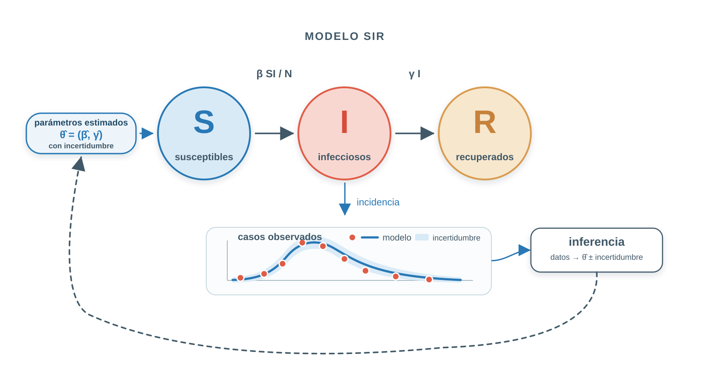

## Material del minicurso

En esta página se encuentran las **diapositivas, datos y ejemplos computacionales** utilizados durante el minicurso **Modelos matemáticos de enfermedades infecciosas con Python**.

### Día 1 — 3 de Noviembre de 2026

- 📄 [Diapositivas](./downloads/diapositivas_dia1.pdf)
- 💻 <a href="./downloads/clase_01_sir.ipynb" download>Descargar Laboratorio 1: Del mecanismo al modelo SIR</a>
- 💻 <a href="./downloads/tarea_01_intervencion_sir.ipynb" download>Descargar Tarea 1</a>
 

### Día 2 — 4 de Noviembre de 2026 
- 💻 <a href="./downloads/clase_02_fit_sir.ipynb" download>Descargar Clase 2: Ajuste determinista, predicción e incertidumbre</a>
- 💻 <a href="./downloads/tarea_02_sirs_estacional.ipynb" download>Descargar Tarea 2</a>
- 📊 <a href="./downloads/datos_tarea_02_sirs_estacional.csv" download>Descargar datos para Tarea 2</a>

### Día 3 — 5 de Noviembre de 2026 
- 📄 [Diapositivas](./downloads/diapositivas_dia3.pdf)

 
### Día 4 — 6 de Noviembre de 2026 

- 📄 Material próximamente.

